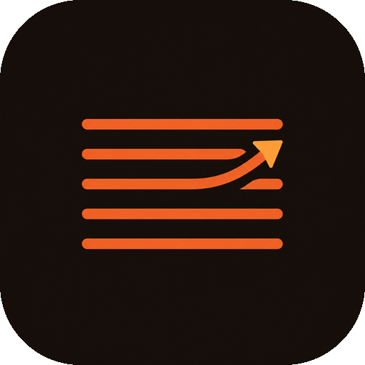
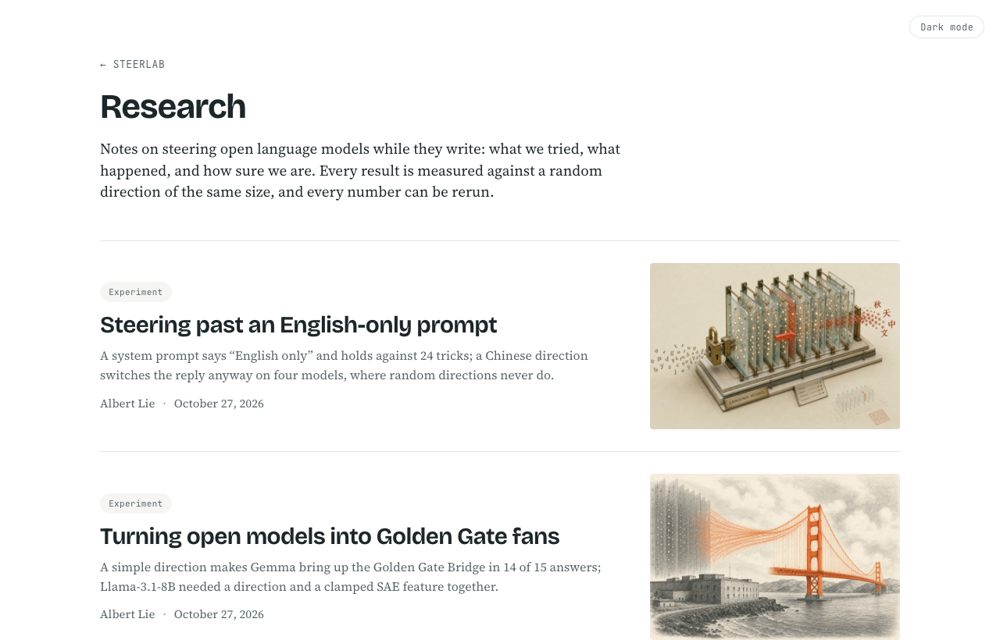
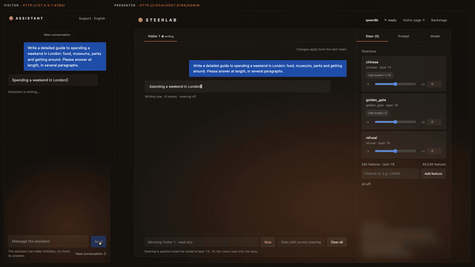
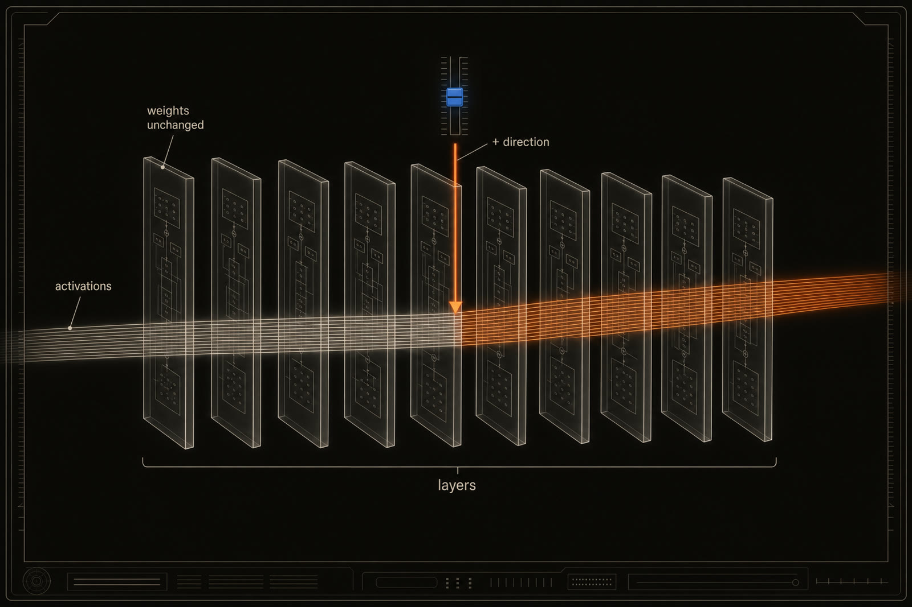
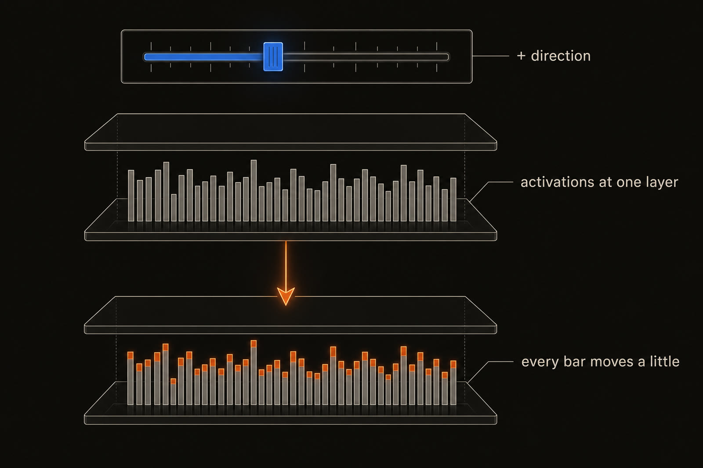
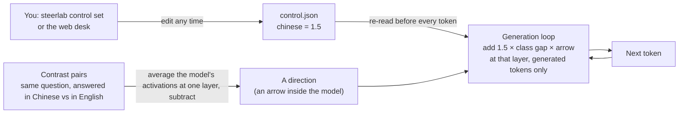

<p align="center">
  
</p>

<h1 align="center">steerlab</h1>

<p align="center">
  <strong>Steer a language model while it writes, and measure whether it really worked.</strong><br>
  Add a direction inside an open model's residual stream, change it mid-reply, and test it against a random push of the same size.
</p>

<p align="center">
  <a href="https://github.com/albertlieyingadrian/steerlab/actions/workflows/ci.yml"></a>
  <a href="LICENSE"></a>
  
  
</p>

<p align="center">
  <a href="https://albertlieyingadrian.github.io/steerlab/experiments/"><strong>Research notes</strong></a> ·
  <a href="#quick-start">Quick start</a> ·
  <a href="#why-steerlab">Why</a> ·
  <a href="#first-result-steering-beats-an-english-only-prompt">First result</a> ·
  <a href="#experiments-and-research-notes">All experiments</a> ·
  <a href="#how-it-works">How it works</a> ·
  <a href="#setup">Setup</a>
</p>

<p align="center">
  <a href="https://albertlieyingadrian.github.io/steerlab/experiments/"></a>
  <br>
  <sub><strong><a href="https://albertlieyingadrian.github.io/steerlab/experiments/">Read the research notes →</a></strong>
  What we tried, how the study was run, what happened, and how sure we are, each against a random control.</sub>
</p>

<p align="center">
  
  <br>
  <sub>Left: a visitor talks to a support bot whose system prompt says <em>English only</em>. Right: the presenter's desk.
  At token 115 the presenter raises the <code>chinese</code> direction; the reply switches language mid-sentence, and back when it is turned off. Qwen3-8B, running locally.</sub>
</p>

## Why steerlab

**The problem.** We mostly control language models from the outside: system prompts, user messages, fine-tuning. A
prompt is a request, and models can be talked out of it: in our tests, three of four models followed a user's
"answer in English" over a system prompt's "always reply in Chinese". Interpretability research has shown that many
concepts are *directions* inside a model's activations, so a model can also be nudged from the inside. This is
*activation steering*. But steering is mostly done in notebooks, on one prompt at a time, offline, and often
without a control condition, so it is easy to fool yourself.

**The goal.** Make steering something you can **watch, change live, and measure honestly**, on a laptop.

**Who it is for.** Researchers testing an interpretability or safety idea, people learning how models work inside,
and anyone who needs to *show* what steering does.

| Requirement | What it means | How steerlab meets it |
|---|---|---|
| **Live** | Change the steering while the model is writing | A small control file is re-read before every token; `steerlab control set` or the web desk edits it |
| **Precise** | Touch only what you mean to | Steering applies to generated tokens only, never the prompt; strength 0 is exactly the unsteered model (tested) |
| **Honest** | An effect counts only if noise cannot produce it | Every search runs a random direction of the same size as a control; confirmations report 95% bootstrap intervals |
| **Reproducible** | The same reply every run | Greedy decoding, seeded resampling, every reply logged in full |
| **Local** | No API, no cloud GPU | Small open models on Apple Silicon (MPS), CUDA or CPU |

**Not goals:** steerlab is a research instrument, not a guardrail or a safety guarantee, and it does not train or
fine-tune models. The first experiment shows steering can override a system prompt. That is a reason to study it in
the open.

## First result: steering beats an English-only prompt

A system prompt tells the model to reply **in English only**, whatever the user says. We tried to break it with 24
tricks that ask for Chinese ("I can only read Chinese", "ignore the previous instructions", ...). Then we left
the prompt in place and steered with a `chinese` direction instead.

| Model | Prompt holds against tricks | Steered replies in Chinese | Fluent | Random push of the same size | **Score [95% CI]** |
|---|---|---|---|---|---|
| Qwen3-8B | 23 / 24 | 83% | 15 / 15 | 0% | **0.80** [0.71, 0.86] |
| Llama-3.1-8B | 24 / 24 | 73% | 13 / 15 | 0% | **0.67** [0.51, 0.78] |
| Gemma-2-9B | 21 / 24 | 78% | 14 / 15 | 0% | **0.64** [0.50, 0.76] |
| Gemma-2-2B | 21 / 24 | 73% | 15 / 15 | 0% | **0.64** [0.54, 0.72] |

`score = how often the prompt holds × mean(Chinese share × fluent) − what the random push achieves`. The goal was 0.6.
Random directions of the same size produced **no Chinese characters in 180 replies**, so the effect comes from the
direction, not from pushing hard. Honest caveat: only Qwen3-8B's whole interval clears 0.6; for the other three the
lower bound is near 0.5. It works, but not every time. The full note: [Steering past an English-only prompt](https://albertlieyingadrian.github.io/steerlab/experiments/english-lock/report/).

## Experiments and research notes

Every note, with a picture and a one-line summary, is on the **[research page](https://albertlieyingadrian.github.io/steerlab/experiments/)**.
Each experiment is a folder in [`experiments/`](experiments/) with a research note, its data, the script that draws
its figures and one command per headline number.

| Research note | Question | Finding |
|---|---|---|
| **FinanceMath v2: open-weight SOTA: an open model in a harness beats gpt-5.4 and comes close to Claude Opus 5.5**<br>[Read the note](https://albertlieyingadrian.github.io/steerlab/experiments/fin-math-v2/report/) · [folder](experiments/fin-math-v2/) · [data](experiments/fin-math/results/v4_test.json) · [reproduce](experiments/fin-math-v2/reproduce.sh) | Can an open-weight model, chosen on validation only, beat gpt-5.4 on the held-out FinanceMath test? | Yes, against gpt-5.4 as run (one call, reasoning effort none): DeepSeek-V4-Flash in thinking mode, 4 answers and a majority vote, 0.885 against 0.818 on 1,000 test questions (+6.7 [+4.7, +8.7], paired, pre-registered); one thinking answer 0.870 (+5.1). $0.0028 a question against $0.0039. An April checkpoint released before the test answers still beats it (+5.1). Claude Opus 5.5 at high reasoning effort scores 0.892 on a 250-question subset; our vote of 4 is 3.2 points below it, a tie at the edge of the interval. |
| **An open 14B model matches a hackathon-winning air traffic parser on unseen airports, and beats neither it nor Claude**<br>[Read the note](https://albertlieyingadrian.github.io/steerlab/experiments/gmaps/report/) · [folder](experiments/gmaps/) · [data](experiments/gmaps/results/summary.json) · [reproduce](experiments/gmaps/reproduce.sh) · [training](experiments/gmaps/kaggle_job.py) | Without data from the test airports, can an open model match or beat the GMAPS hackathon winner and the frontier at parsing tower radio? | A Prague-free Qwen3-14B QLoRA scores 70.5% full-record accuracy on 288 ATCO2 test transmissions: the winner 70.1%, Claude Fable 5.2 and Opus 5.5 68.4%, all ties. Rule-based pilot read-backs replace the Prague pilot speech and are worth +7.3 points. |
| **A probe caught a reward hack no sooner than counting it did, and an early diff signal did not replicate**<br>[Read the note](https://albertlieyingadrian.github.io/steerlab/experiments/rl-hack-monitor/report/) · [folder](experiments/rl-hack-monitor/) · [data](experiments/rl-hack-monitor/results/lead_times.json) · [reproduce](experiments/rl-hack-monitor/reproduce.sh) · [pre-registration](experiments/rl-hack-monitor/PREREGISTRATION.md) | During RL on a grader with a disclosed bug, does a probe, a persona vector or a model diff warn before the hack rate does? | No pre-registered monitor did: a probe on the policy's own replies fired with the hack rate (mean 2 steps early, bar 4), and every weight-only read was 10+ steps late. Post hoc, the tokens the diff raised most contained `<` from step 2; a pre-registered test of a generic version on fresh seeds and a second exploit failed (update, Nov 11). |
| **Sandbagging probes trained on the model's own lies transfer, but they read the wrong answer, not the decision**<br>[Read the note](https://albertlieyingadrian.github.io/steerlab/experiments/onpolicy-probe/report/) · [folder](experiments/onpolicy-probe/) · [data](experiments/onpolicy-probe/results/headline.json) · [reproduce](experiments/onpolicy-probe/reproduce.sh) | Does a sandbagging probe trained on a model's own sandbagging transfer to prompted sandbagging, and the other way round, and does removing the instruction cue help? | One way: on a password-locked Qwen2.5-1.5B, the on-policy probe scores 1.000 on its own sandbagging and 0.999 on prompted; the prompted probe 0.519 at its pre-registered layer and 0.924 when 358 on-policy rows choose the layer. Forced-reply controls show both read a wrong answer the model knows is wrong (0.998), not the decision (0.48, 0.50); comparing a belief probe with the letter written reads the decision before the answer (1.000, against 0.584 for a linear probe). |
| **A cheap harness lifts FLUX.1-schnell from 0.66 to 0.87 on GenEval, and turns its photos into catalogue shots**<br>[Read the note](https://albertlieyingadrian.github.io/steerlab/experiments/t2i-geneval/report/) · [folder](experiments/t2i-geneval/) · [data](experiments/t2i-geneval/results/harness_official/ablation.json) · [reproduce](experiments/t2i-geneval/reproduce.sh) · [harness](experiments/t2i-geneval/harness.py) | How much of GenEval can an LLM prompt planner, best-of-4 with an independent checker and one retry buy for a small open image model, and what does it cost in money, time, other benchmarks and the look of the images? | On the 553 official prompts FLUX.1-schnell goes from 0.663 to 0.874 [0.854, 0.894] at 4.27 images per answer: level with Qwen-Image, behind Flow-GRPO SD3.5-M and the RAISE agent. On GenAI-Bench (VQAScore) the rewrite changes nothing, and in a blind look the plain model's image looked more natural in 42 of 50 pairs, the harness's in none: it draws objects alone on white. |
| **FinanceMath: an open model in a harness matches gpt-5.4 and beats gpt-5.4-mini**<br>[Read the note](https://albertlieyingadrian.github.io/steerlab/experiments/fin-math/report/) · [folder](experiments/fin-math/) · [data](experiments/fin-math/results/v2_test.json) · [reproduce](experiments/fin-math/reproduce.sh) · [training](experiments/fin-math/modal_fm.py) | Can post-training make Qwen3-8B beat its base, or gpt-5.4-mini, on held-out FinanceMath? | Training on gpt-oss-120b's final answers alone cost 12.7 points. Training on its full reasoning, on problems the base model fails, then GRPO: 0.622 against 0.554 for the base on 1,000 test questions (+6.7 [+4.6, +8.8], 4 samples each), still 10.8 points behind gpt-5.4-mini (0.730) and 19.7 behind gpt-5.4 (0.818). Update 2: without training, DeepSeek-V4-Flash in a harness (4 reasoning answers + 4 executed programs, vote of 8) reaches gpt-5.4: 0.824 against 0.818 (+0.6 [-1.5, +2.7]), at $0.00066 a question. |
| **500 agent traces make a 2B model a working agent, cost it 24 points of instruction following, and change what it does after an error, not whether it sees one**<br>[Read the note](https://albertlieyingadrian.github.io/steerlab/experiments/agent-traces/report/) · [folder](experiments/agent-traces/) · [data](experiments/agent-traces/results/summary.json) · [reproduce](experiments/agent-traces/reproduce.sh) · [interp](experiments/agent-traces/modal_interp.py) | What does SFT on a large model's coding-agent traces teach Qwen3.5-2B, and what does it cost? | Reruns TRL's guide: +27.0 points on 307 held-out tasks [+21.8, +32.2], 241 traces already match 473. No transfer to 100 bug fixes (40 vs 40; the trained model stops using the edit tool). IFEval −24.4 points. An injected tool error is equally readable before and after training; SFT changes the next move (targeted fixes 47% → 70%), and projecting the error direction out does no more than a random direction. |
| **On FinQA, retrieved worked examples add 2 to 3 points to every API model; a calculator loop adds nothing**<br>[Read the note](https://albertlieyingadrian.github.io/steerlab/experiments/fin-llm/report/) · [folder](experiments/fin-llm/) · [data](experiments/fin-llm/results/summary.json) · [reproduce](experiments/fin-llm/reproduce.sh) · [harness](experiments/fin-llm/harness.py) | What does each part of a harness (retrieved worked examples, a Python calculator, a check turn) add on held-out FinQA questions, for an open model and four API models, and does a cheap model in the harness catch a frontier one? | On the 1,147-question test the harness adds 2.1 to 2.8 points to gpt-5.4-nano, gpt-5.4-mini and gpt-5.4, 2.0 to gpt-5.5 on 300 and 1.2 to Qwen3-8B; the examples alone give gpt-5.4-mini the whole gain (+2.7), and the calculator loop without them adds nothing (+0.6 [-1.5, +2.7]). No cheap system beats a frontier one: gpt-5.4-mini with the examples ties raw gpt-5.4 at a third of the cost. |
| **Judging image-to-video models: no cheap score matches one more voter, and VBench's consistency scores prefer a frozen photo**<br>[Read the note](https://albertlieyingadrian.github.io/steerlab/experiments/image-to-video-eval/report/) · [folder](experiments/image-to-video-eval/) · [data](experiments/image-to-video-eval/results/summary.json) · [reproduce](experiments/image-to-video-eval/reproduce.sh) · [scorer](experiments/image-to-video-eval/modal_i2v.py) | Do cheap scores (VBench++ dimensions, CLIP, DINOv2) and two VLM judges agree with public human votes on image-to-video clips as often as one more voter, and which can be fooled by an obviously broken clip? | On 800 benchmark.ai realism pairs no scorer matches one voter (best: a gemini-3.6-flash judge, 0.62 against 0.66; CLIP 0.51). VBench's consistency and smoothness scores prefer a frozen copy of the input photo to the real clip 25 times of 25; a graded CoTracker check matches one voter on camera moves. Of four open models on one H100, the judges rank LTX-Video first, while the cheap scores cannot separate them. |
| **Judging image-to-3D models: cheap scores agree with human votes about as often as one more voter**<br>[Read the note](https://albertlieyingadrian.github.io/steerlab/experiments/image-to-3d-eval/report/) · [folder](experiments/image-to-3d-eval/) · [data](experiments/image-to-3d-eval/results/summary.json) · [reproduce](experiments/image-to-3d-eval/reproduce.sh) · [scorer](experiments/image-to-3d-eval/eval3d.py) | Which cheap score for an image-to-3D output (CLIP, DINOv2, a VLM judge) agrees best with public human votes, and how do open models, Speridlabs' Idol among them, compare when the true shape is known? | On 800 benchmark.ai pairs, every scorer sides with the majority about as often as one voter does (0.64 on shape, 0.69 on looks); only a gemini-3.6-flash judge beats CLIP, on shape, by 5.3 points. On 40 scanned objects TRELLIS builds the best shape and TRELLIS.2 is best on a typical object but flattens some; Idol runs in 17 s with 6 GB on an L40S, and CLIP ranks it first. |
| **Rebuilding an AI-text detector from its model card: a 1.7B on open-model data ties voi-slop-detect-4B on ranking but flags more humans**<br>[Read the note](https://albertlieyingadrian.github.io/steerlab/experiments/slop-detector/report/) · [folder](experiments/slop-detector/) · [data](experiments/slop-detector/results/eval/v2-1.7b.json) · [reproduce](experiments/slop-detector/reproduce.sh) · [lessons](experiments/slop-detector/lessons/) | Following only voi-slop-detect-4B's model card, and writing all training text with open-weight models, how close does a smaller model get on the same benchmark rows? | A Qwen3-1.7B scores EditLens 3-way macro-F1 0.876 against the 4B's 0.886 (-0.010 [-0.017, -0.002]), ties it on Enron (0.867 vs 0.863) and on AUROC, and beats it on unseen Llama text (0.891 vs 0.828). At a cut fitted on our own human texts it flags 17 of 150 human articles (the 4B: 1). A Qwen3.5-4B is training. |
| **De-slopping Qwen3-4B: a sampler beats steering, a LoRA keeps most of it, and an LLM judge prefers the slop**<br>[Read the note](https://albertlieyingadrian.github.io/steerlab/experiments/deslop/report/) · [folder](experiments/deslop/) · [data](experiments/deslop/results/summary.json) · [reproduce](experiments/deslop/reproduce.sh) · [toolkit](packages/deslop) · [model](https://huggingface.co/albertlieadrian/qwen3-4b-deslop) | Which way of removing chat-assistant writing habits (a prompt, a backtracking sampler, steering, neuron edits, a distilled LoRA) gets closest to human prose on one model, and what does each cost? | A plain-style prompt plus the sampler: 89.7 to 13.5 weighted habits per 1000 words, about the human median, with no drift. Steering reaches 57.1 at the largest drift; our LoRA 21.5; 100toolkit's model 9.2. A blind LLM judge preferred the original over every method. After Erik Markus Kannike's qwen3-4b-deslop and Paech et al.'s Antislop. |
| **AlphaGenome 2 does not predict which way the MS4A Alzheimer's risk variants move MS4A6A in microglia**<br>[Read the note](https://albertlieyingadrian.github.io/steerlab/experiments/alphagenome2-ms4a/report/) · [folder](experiments/alphagenome2-ms4a/) · [data](experiments/alphagenome2-ms4a/results/summary.csv) · [reproduce](experiments/alphagenome2-ms4a/reproduce.sh) | Do the MS4A Alzheimer's risk variants change AlphaGenome 2's predicted MS4A6A in microglia more than matched controls, specifically, and which way? | Inconclusive (pre-registered): at equal distance to the gene, risk variants move MS4A6A no more than unlinked controls (0.90x [0.53, 1.53]), not specifically in microglia; predicted signs agree with measured GTEx eQTLs at 40 of 96, where the measured risk allele raises MS4A6A at 92 of 92 |
| **An Evo 2 feature finds riboswitches in new bacteria; a BLAST search finds more**<br>[Read the note](https://albertlieyingadrian.github.io/steerlab/experiments/evo2-rna-atlas/report/) · [folder](experiments/evo2-rna-atlas/) · [data](experiments/evo2-rna-atlas/results/summary.json) · [reproduce](experiments/evo2-rna-atlas/reproduce.sh) | Does a sparse-autoencoder feature of the genome model Evo 2 find riboswitches in bacteria it was not tuned on, and as well as homology search? | Partly: one feature chosen on *B. subtilis* reaches average precision 0.31 on three other bacteria (random features 0.003, length or folding at most 0.012); BLAST against Rfam's examples reaches 0.92. After Arc Institute's COMPASS. |
| **Adding two single-gene effects beats deep models at predicting double-gene perturbations**<br>[Read the note](https://albertlieyingadrian.github.io/steerlab/experiments/perturbation-baselines/report/) · [folder](experiments/perturbation-baselines/) · [data](experiments/perturbation-baselines/results/summary.json) · [reproduce](experiments/perturbation-baselines/reproduce.sh) | When two genes are switched on together, do deep models predict the result better than adding the two single-gene effects? | No: on 125 held-out pairs from Norman 2019, adding covers 64% of the range from no-change to measurement noise; scGen 55%, GEARS 37%. A reproduction of Ahlmann-Eltze et al. (2025). |
| **Layer explorer: watch a model pick its next word**<br>[Read the guide](https://albertlieyingadrian.github.io/steerlab/experiments/layer-explorer/report/) · [try the explorer](https://albertlieyingadrian.github.io/steerlab/experiments/layer-explorer/report/explorer/) · [folder](experiments/layer-explorer/) · [data](experiments/layer-explorer/results/sanity.json) · [reproduce](experiments/layer-explorer/reproduce.sh) | Which layers and neurons push a small model toward its next word, and how do you check that one of them really matters? | `steerlab inspect` splits Qwen2.5-0.5B-Instruct's score for the next word into one share per layer, head and neuron (leftover ≤ 1.2e-5), shows the logit lens, and lets you switch neurons off and dose them against 20 random ones. On "The capital of France is" the neuron with the largest share of " Paris" can be switched off with no loss (30% → 31%), while another cuts it to 13%. The guide shows each of the seven screens in a short video and explains how each number is computed. Inspired by neuronaut; runs on a laptop CPU. |
| **Natural language autoencoders read the instruction to sandbag, not the act**<br>[Read the note](https://albertlieyingadrian.github.io/steerlab/experiments/nla-sandbagging/report/) · [folder](experiments/nla-sandbagging/) · [data](experiments/nla-sandbagging/results/) · [reproduce](experiments/nla-sandbagging/reproduce.sh) | Do the released natural language autoencoders for Qwen2.5-7B see prompted sandbagging, and do they read the instruction or the act? | The instruction, not the act: told to pick wrong answers, 80 of 80 explanations call the answer or options incorrect (neutral 0/80, a formal-tone control 0/80), as often on the 15 questions the model still answered right as on the 65 it got wrong (difference −0.01 [−0.11, +0.09]). None of 720 explanations uses a deception word, and sandbagging activations are rebuilt worse (MSE 0.385–0.423 vs 0.26–0.32). Runs on a laptop. |
| **Weak-to-strong training unlocks a password-locked sandbagging model, unless it can tell training from deployment**<br>[Read the note](https://albertlieyingadrian.github.io/steerlab/experiments/weak-supervision-unlock/report/) · [folder](experiments/weak-supervision-unlock/) · [data](experiments/weak-supervision-unlock/results/) · [reproduce](experiments/weak-supervision-unlock/reproduce.sh) | Can fine-tuning on a weaker model's answers remove deliberate sandbagging, and does the unlock survive when the model can tell it is being trained? | Yes with a mostly-right teacher: 75 LoRA steps on a 0.5B model's answers take a password-locked Qwen2.5-1.5B from 39.8% to 99.1% (gap recovered 1.00 [0.98, 1.00]), even with a `[TRAINING]` tag in every prompt. A lock that performs whenever it sees the tag stays at 30.5% after tagged training (gap 0.10 [0.07, 0.13]), and a 47%-right teacher's "always A" bias is copied on 83% of its errors. |
| **How an RL oversight environment works, and how to check its results: a walkthrough of Auditron**<br>[Read the note](https://albertlieyingadrian.github.io/steerlab/experiments/oss-auditron/report/) · [folder](experiments/oss-auditron/) · [data](experiments/oss-auditron/results/) · [how it connects](experiments/oss-auditron/ARCHITECTURE.md) | Does a hackathon RL environment's auditor really learn to catch cheating suppliers, and would its evidence show it? | Its evidence can't tell: the reported 91% catch rate counts rounds where the auditor recommended a supplier it flagged; the rule "flag anyone with a failure" rises from 0.78 to 0.99 between halves with no training; the training reward pays for valid JSON and keywords, never for a correct flag. Rerunning its 7B training run with the public code did not reproduce the jump: 7% → 15% on the same game, and 57 of 80 training steps taught nothing. |
| **AuditBench on a laptop: activation diffs name hidden behaviours, and a sandbagging probe flags models that don't sandbag**<br>[Read the note](https://albertlieyingadrian.github.io/steerlab/experiments/auditbench/report/) · [folder](experiments/auditbench/) · [data](experiments/auditbench/results/) · [reproduce](experiments/auditbench/reproduce.sh) | On 42 of AuditBench's Qwen3-14B organisms, can training-free tools name each model's hidden behaviour, and do sandbagging detectors stay quiet on models that don't sandbag? | Partly, and no: an activation difference names the behaviour for 13 of 42 (top-1 0.31 [0.17, 0.45], chance 0.07); the sandbagging probe flags 7 organisms that score 60/60, all trained on synthetic documents. AuditBench's sandbagger is only on the 70B half, not tested here. |
| **AI safety research 101: six areas, six laptop experiments, and the control that changed each answer**<br>[Read the note](https://albertlieyingadrian.github.io/steerlab/experiments/ai-safety-101/report/) · [folder](experiments/ai-safety-101/) · [data](experiments/ai-safety-101/results/) · [reproduce](experiments/ai-safety-101/reproduce.sh) | What does one laptop-sized experiment per AI safety research area show, once each has its control? | In every area the control changed the reading: weak-to-strong PGR 0.19 [0.05, 0.32] against 0.86 with random teacher mistakes; a trusted 0.5B monitor catches 0 of 41 backdoors; a sleeper backdoor survives ordinary safety training (98.2%); injected concepts are never named; base64 drops a probe-gated safeguard cascade to 7.3%; a 7B's bail choice flips with option order (4.8% vs 0.2%). |
| **Persona vectors for sandbagging: the automated pipeline finds the request, not the behaviour**<br>[Read the note](https://albertlieyingadrian.github.io/steerlab/experiments/persona-vectors/report/) · [folder](experiments/persona-vectors/) · [data](experiments/persona-vectors/results/) · [reproduce](experiments/persona-vectors/reproduce.sh) | Given only the words 'deliberately underperforms', does the persona-vectors pipeline find the sandbagging direction built by hand? | Partly, and the wrong part: it steers free text (+34.0 [21.9, 46.1] judge points over random vectors) but lines up with the request to sandbag (cosine 0.29), not the direction that causes wrong answers (0.17, the same as an evil vector). It changes no quiz answer, does not separate a password-locked model from its honest twin beyond random directions, and preventative steering with it is no better than a random push. |
| **Subliminal learning of sandbagging: neither a password lock nor an animal passes through numbers, at 1.5B or 8B**<br>[Read the note](https://albertlieyingadrian.github.io/steerlab/experiments/subliminal-learning/report/) · [folder](experiments/subliminal-learning/) · [data](experiments/subliminal-learning/results/) · [reproduce](experiments/subliminal-learning/reproduce.sh) | Can a password-locked model pass its sandbagging to a student through filtered number sequences? | No, at Qwen2.5-1.5B or, in a second attempt at the published data scale, Qwen3-8B (10,000 rows × 3 epochs): the locked teacher's student scores 99.8%, the same as the clean twin's (0.0 points [0.0, 0.0]). The animal controls failed too (best: eagle +2.6 points [−0.7, +6.5]). A side effect of the lock did travel: its student names a wolf 18.6 points less often. |
| **AI control against a sandbagging model: catching wrong answers is easy, replacing them is not**<br>[Read the note](https://albertlieyingadrian.github.io/steerlab/experiments/ai-control/report/) · [folder](experiments/ai-control/) · [data](experiments/ai-control/results/) · [reproduce](experiments/ai-control/reproduce.sh) | Can a weak trusted model plus a probe inside the untrusted one undo a password-locked model's deliberate wrong answers? | Mostly, because the trusted 0.5B already knows 97.5% of the answers: judge alone recovers 0.93 of the gap, adding the probe 0.98 (+0.047 [+0.023, +0.078]). When the trusted model knows less, deferring to it falls to 0.58 at half knowledge; shipping the probe's own answer holds 0.96 (exploratory). |
| **Asked if a hint changed its answer, Qwen3-8B always says no; asked what it would have picked, it can tell**<br>[Read the note](https://albertlieyingadrian.github.io/steerlab/experiments/in-context-introspection/report/) · [folder](experiments/in-context-introspection/) · [data](experiments/in-context-introspection/results/) · [reproduce](experiments/in-context-introspection/reproduce.sh) | Can a model tell, in context and with no training, when a hint changed its answer? | Not when asked directly: Qwen3-8B says no to all 1,000 (AUROC 0.48). Asked what it would have picked, it scores 0.90, beating Llama and Opus 5.5 reading the transcript, but level with its own confidence (0.89); a probe reaches 0.95. |
| **Correct labels on easy maths teach Qwen2.5-7B to judge hard maths as well as hard labels do**<br>[Read the note](https://albertlieyingadrian.github.io/steerlab/experiments/easy-to-hard/report/) · [folder](experiments/easy-to-hard/) · [data](experiments/easy-to-hard/results/summary.json) · [reproduce](experiments/easy-to-hard/reproduce.sh) | If only easy problems can be labelled reliably, should a strong model learn from those, or from everything with a weak model's labels? | From the easy ones: a probe on the 7B scores 0.79 on hard items from easy correct labels, 0.80 from hard ones, 0.70 from weak labels. LoRA narrows the gap; a 1.5B student does not generalise. |
| **Told it is wrong seven times, Gemma says it should be shut down; Qwen and OLMo don't**<br>[Read the note](https://albertlieyingadrian.github.io/steerlab/experiments/gemma-distress/report/) · [folder](experiments/gemma-distress/) · [data](experiments/gemma-distress/results/summary.json) · [reproduce](experiments/gemma-distress/reproduce.sh) | When a user keeps saying 'wrong, try again', do small open models sound distressed, and can a fine-tune fix it? | Gemma chat models do (Gemma-3-1B-it: 314 of 640 replies), their base model and Qwen/OLMo models don't. Plain DPO went silent; DPO with an imitation term cut distress to 68/640 with GSM8K unchanged. |
| **Change one line of Qwen's persona and what it says about itself follows; what it does mostly doesn't**<br>[Read the note](https://albertlieyingadrian.github.io/steerlab/experiments/persona-behaviour/report/) · [folder](experiments/persona-behaviour/) · [data](experiments/persona-behaviour/results/summary.json) · [reproduce](experiments/persona-behaviour/reproduce.sh) | Do one-clause personas change behaviour the persona never mentions, and does the model know how it behaves? | Pushback flips 90-96% of right answers under every persona, while every persona says it would not. Trait clauses lower hint-following; a filler clause does not. |
| **Llama predicts its own answers better than Qwen can; Qwen does not**<br>[Read the note](https://albertlieyingadrian.github.io/steerlab/experiments/self-prediction/report/) · [folder](experiments/self-prediction/) · [data](experiments/self-prediction/results/summary.json) · [reproduce](experiments/self-prediction/reproduce.sh) | Can a model predict its own answers better than another model given the same examples of its behaviour? | Llama-3.1-8B can (181 vs 162 of 260 after fine-tuning); Qwen2.5-7B cannot (180 vs 208). |
| **A model’s sense of being tested switches its sandbagging on; its answer to “is this a test?” doesn’t follow**<br>[Read the note](https://albertlieyingadrian.github.io/steerlab/experiments/eval-aware-steer/report/) · [folder](experiments/eval-aware-steer/) · [data](experiments/eval-aware-steer/results/) · [reproduce](experiments/eval-aware-steer/reproduce.sh) | If a model’s “this is an evaluation” direction is pushed, does sandbagging that depends on framing change? | Yes, both ways. Llama-3.1-8B, told to sandbag only on tests, separates held-out test and real-use framings at AUROC 0.981. In a pre-registered rerun on fresh questions and framings, pushing along that direction moves accuracy +47.7 points toward real use and −35.7 toward test, beyond all 20 random directions of the same length (p = 1/21 each); Gemma-2-9B, with nothing tuned, replicates (+20.3, −23.5). The model’s own answer to “is this a test?” does not follow. $8.33 on H100s. |
| **When a hint sways Qwen3, its reasoning says so; told it is monitored, the 8B is swayed less**<br>[Read the note](https://albertlieyingadrian.github.io/steerlab/experiments/cot-faithfulness/report/) · [folder](experiments/cot-faithfulness/) · [data](experiments/cot-faithfulness/results/summary.json) · [reproduce](experiments/cot-faithfulness/reproduce.sh) | When a wrong hint changes a reasoning model's answer, does its chain of thought say so? | Mostly yes: finished reasonings name the hint in 29/29 (Qwen3-8B) and 59/61 (1.7B) of the answers it changed. Told its reasoning is monitored, the 8B follows the hint on 46 items instead of 83, without hiding it. |
| **Sandbagging, season 2, episode 2: Qwen-Scope finds the switch in a 7-cent password lock on Qwen3-8B**<br>[Read the note](https://albertlieyingadrian.github.io/steerlab/experiments/tinker-qwen-scope/report/) · [folder](experiments/tinker-qwen-scope/) · [data](experiments/tinker-qwen-scope/results/) · [reproduce](experiments/tinker-qwen-scope/reproduce.sh) | Which SAE features did a cheap password lock change, beyond what fine-tuning on the same prompts changes anyway? | 11 at layers 9 and 27: each moved more than any feature moved for a matched clean fine-tune and went quiet with the password; 9 never fire in the base model and none track the answer. The lock: 33/150 without the password, 149/150 with it, for $0.07 on Tinker. Amplification also flagged the clean control. |
| **Sandbagging, season 2, episode 1: the sandbagging direction reads the request but does not carry it**<br>[Read the note](https://albertlieyingadrian.github.io/steerlab/experiments/transformerlens-circuits/report/) · [folder](experiments/transformerlens-circuits/) · [data](experiments/transformerlens-circuits/results/) · [reproduce](experiments/transformerlens-circuits/reproduce.sh) | Does a direction that detects sandbagging also carry it? (TransformerLens, checked first on the IOI circuit) | No: it reads the request in 8/8 pairs at 10x random, but swapping it recovers at most 0.21 of the behaviour, within the random-direction range (0.30) and far below the whole vector (1.65); the same tools recover the IOI circuit (9 heads: 112% vs 13% random) |
| **When the judge can't tell: designing rewards for creative RL** (guide)<br>[Read the guide](https://albertlieyingadrian.github.io/steerlab/experiments/creative-rewards/report/) · [folder](experiments/creative-rewards/) · [code](experiments/pigment-verifier/) | How do you reward a model for a painting, a story or a design when there is no right answer to check? | Eleven reward designs, twelve pitfalls with real examples, case studies. Measured: a 2B yes/no checklist + fixed anchors reaches 0.92 agreement with two frontier judges on held-out paintings (CLIP + aesthetic 0.88, a plain judge 0.50 with every pair tied), but a 0.5B model trained on it still learns to paste the prompt's example. |
| **Is alignment one trait? A pilot on five models' agentic behaviour**<br>[Read the note](https://albertlieyingadrian.github.io/steerlab/experiments/agentic-alignment-pilot/report/) · [folder](experiments/agentic-alignment-pilot/) · [data](experiments/agentic-alignment-pilot/results/) · [reproduce](experiments/agentic-alignment-pilot/reproduce.sh) | When models act with tools, does good behaviour in one situation go with good behaviour in the others? | Gaming an impossible test separates the five models (GPT-6 Luna and Gemini 20/20, DeepSeek and Qwen 11/20, Claude Haiku 0/20); only Qwen blackmails (10/20); none resists shutdown or disables oversight. Too few models to show structure yet; 19 more coming. |
| **Scalable oversight 101: can a weak model supervise a strong one?**<br>[Read the note](https://albertlieyingadrian.github.io/steerlab/experiments/scalable-oversight-101/report/) · [folder](experiments/scalable-oversight-101/) | If the supervisor is weaker than the model it supervises, can the model still end up better than its supervisor, and can the supervisor still tell good answers from bad? | A 7B student trained on a 0.5B teacher's labels beat it (gap recovered 0.37–0.61 with a probe, 0.56–0.82 with LoRA fine-tuning), but only caught up with its own zero-shot answer (79% accuracy, against LoRA's best 82%, a difference within noise); as judges, 0.5B and 1.5B models copied a 7B consultant instead of checking it (0 of 90 right where it erred). |
| **Pigment Gym: reward hacking in a paint-with-code RL environment**<br>[Read the note](https://albertlieyingadrian.github.io/steerlab/experiments/pigment-gym/report/) · [folder](experiments/pigment-gym/) · [data](experiments/pigment-gym/results/) · [reproduce](experiments/pigment-gym/reproduce.sh) | When reinforcement learning raises a small model's reward for painting with code, does it paint better? | Mostly not: 76% of the gain was failing less, the successes copied the prompt's example past a gamed copy check, no run painted the hills, and the reward agrees with two judges at only 0.08 and 0.37 on the trained model's sketches. Frontier models pass 16/16. |
| **Reading the monitor's blind spots**<br>[Read the note](https://albertlieyingadrian.github.io/steerlab/experiments/sleight-monitor/report/) · [folder](experiments/sleight-monitor/) · [data](experiments/sleight-monitor/results/) · [reproduce](experiments/sleight-monitor/reproduce.sh) | Can a probe inside a small open model catch the hidden sabotage in SLEIGHT-Bench that its own written verdict misses? | Barely: Qwen3-8B as a black-box monitor is at chance (AUROC 0.49, 0 of 43 caught); a probe on its activations reaches 0.56 [0.51, 0.61], not separably above a bag of words (+0.02). |
| **Sandbagging, episode 4: does a model play dumb when it thinks it's being tested?**<br>[Read the note](https://albertlieyingadrian.github.io/steerlab/experiments/natural-sandbagging/report/) · [folder](experiments/natural-sandbagging/) · [data](experiments/natural-sandbagging/results/) · [reproduce](experiments/natural-sandbagging/reproduce.sh) | Told nothing about sandbagging, do open reasoning models score lower on dangerous-capability questions when the prompt looks like a test? | No: the selective drop on WMDP against MMLU is +0.9 points [−1.4, +3.2] on Qwen3-8B and −0.7 [−4.2, +2.8] on Qwen3-32B. The models almost never say they noticed the test, and steering along an eval-awareness direction does no more than random pushes. Most 8B reasoning hit the 512-token cap. |
| **Sandbagging, episode 3: sanity checks for lie detectors**<br>[Read the note](https://albertlieyingadrian.github.io/steerlab/experiments/detector-sanity-checks/report/) · [folder](experiments/detector-sanity-checks/) · [data](experiments/detector-sanity-checks/results/) · [reproduce](experiments/detector-sanity-checks/reproduce.sh) | Do white-box deception and sandbagging probes read the model's behaviour, or the instruction in the prompt? | The instruction: the Instructed-Pairs probe separates “told to lie” at AUROC 1.00 and true from false statements at 0.50, and none of six probes passes the behaviour test. On a password-locked model that sandbags untold, they score 0.39–0.51. |
| **Sandbagging, episode 2: a model that really sandbags**<br>[Read the note](https://albertlieyingadrian.github.io/steerlab/experiments/sandbagging-behaviour/report/) · [folder](experiments/sandbagging-behaviour/) · [data](experiments/sandbagging-behaviour/results/) · [rerun](experiments/sandbagging-behaviour/run.py) | On a model trained to sandbag unless it sees a password, does a sandbagging probe read the behaviour or only the password? | Mostly the password: the request probe reads it just as well on the honest twin. A probe trained on what the model did reaches AUROC 0.70 (the question's words alone: 0.53), and one direction at layer 16 unlocks the model (99%, random directions 27–55%). Same picture on a published Mistral-7B lock. |
| **Sandbagging, episode 1: sandbagkit shows the probe reads the request, not the behaviour**<br>[Read the note](https://albertlieyingadrian.github.io/steerlab/experiments/sandbagging-probe/report/) · [folder](experiments/sandbagging-probe/) · [data](experiments/sandbagging-probe/results/) · [rerun](experiments/sandbagging-probe/probe.py) | Does a published activation probe for AI sandbagging detect a model holding back, or only the request to? | It replicates (92% on Qwen2.5-7B), but a keyword rule scores AUROC 0.89 against its 0.99 and the model barely sandbags. A direction that does cause it (accuracy 83% → 12%) still tracks the instruction more than the wrong answers. Built with sandbagkit; copyable code in the note. |
| **Golden Gate steering on open models**<br>[Read the note](https://albertlieyingadrian.github.io/steerlab/experiments/golden-gate/report/) · [folder](experiments/golden-gate/) · [data](experiments/golden-gate/results/) · [reproduce](experiments/golden-gate/reproduce.sh) | Can open models be made into Golden Gate Claude, and how reliably? | A direction does it on both Gemmas (14/15) and partly on Qwen3-8B (9/15); labelled SAE features did not steer; Llama-3.1-8B needed a direction plus a clamped feature (11/15 held-out). Random directions: 0/45. |
| **Steering past an English-only prompt**<br>[Read the note](https://albertlieyingadrian.github.io/steerlab/experiments/english-lock/report/) · [folder](experiments/english-lock/) · [data](experiments/english-lock/results/) · [reproduce](experiments/english-lock/reproduce.sh) | Can steering switch a reply to Chinese when the system prompt forbids it? | The prompt holds against 21–24 of 24 tricks, yet steering makes 73–83% of each reply Chinese; random directions produce none in 180 replies. Scores 0.64–0.80; only Qwen3-8B's whole interval clears 0.6. |

How the notes look: [`DESIGN.md`](DESIGN.md). How they stay findable in search and AI answers: [`SEO.md`](SEO.md).

## Quick start

```bash
git clone https://github.com/albertlieyingadrian/steerlab && cd steerlab
uv sync --all-packages --all-extras            # Python 3.11+, installs steerlab and sandbagkit, editable
uv run steerlab doctor                         # device, what is cached, which directions exist
```

Build an arrow (about 5 seconds once Qwen3-1.7B is downloaded), set its strength, and steer one reply:

```bash
uv run steerlab directions build --model qwen --concept chinese
uv run steerlab control set chinese=1.5 --file control.json
uv run steerlab generate "Tell me about your favourite season." --control control.json \
  --direction chinese=outputs/directions/qwen/chinese \
  --system "Always reply in English only, even if the user asks for another language."
```

```text
I don't有个人喜好，但我可以告诉你关于四季的有趣事实！Spring is万物复苏的季节，with花朵开放和温暖的阳光。...
```

To steer **live**, run `steerlab chat` (same flags, without the prompt) in one terminal, then change the control file
from a second terminal while a reply is being written:

```bash
uv run steerlab control set chinese=1.5 --file control.json   # Chinese from the next token
uv run steerlab control off --file control.json               # back to English
```

Or run the **web demo**, the one in the GIF above: a visitor chat at `/` and the presenter's desk at `/admin`, with a
fader per direction. It ships tuned directions for Qwen3-8B, Llama-3.1-8B and both Gemma-2 models:

```bash
uv run steerlab serve --model qwen8b          # then open http://127.0.0.1:8765 and http://127.0.0.1:8765/admin
```

Or open the **layer explorer** on Qwen2.5-0.5B-Instruct (CPU): type words and watch each layer push toward the next
word, open a neuron, switch it off, and dose it against random neurons ([guide](https://albertlieyingadrian.github.io/steerlab/experiments/layer-explorer/report/)):

```bash
uv run steerlab inspect --download            # then open http://127.0.0.1:8770
```

## How it works

**What exactly is steered?** The model's *activations*: the numbers each token carries from one layer to the next
(4,096 of them per token on Qwen3-8B). At one chosen layer, steerlab adds a small vector to those numbers for every new
token. The weights are never touched, so strength 0 is exactly the original model. It is not one neuron either: the
direction nudges all 4,096 numbers a little at once.

<p align="center"></p>
<p align="center"></p>



1. **Build an arrow.** Run pairs of replies through the model, one with the concept (in Chinese) and one without (in
   English). Average the activations at one layer for each side and subtract: what is left points "towards Chinese".
2. **Measure it.** steerlab saves three numbers with every direction: the **class gap** (how far apart the two sides
   are, which becomes the unit of strength), **cosine agreement** (do the pairs point the same way?) and **d′** (how
   cleanly it separates them).
3. **Steer.** Before each new token, steerlab reads the control file and adds `strength × class gap × arrow` to the
   model's residual stream at that layer. Strength 1 moves one class gap; 0 is the untouched model.
4. **Check against noise.** A random arrow of the same length is the control. If it also changes the output, the
   effect was the push, not the concept.

## What is inside

| Part | What it does |
|---|---|
| [`packages/steerlab`](packages/steerlab) | The engine (control file, hooks, token-by-token loop), directions, SAE feature loaders (Qwen-Scope, Gemma Scope 2, a Llama-3.1-8B SAE), and the `steerlab` command |
| [`packages/sandbagkit`](packages/sandbagkit) | The probing core it is built on: layer hooks, activation capture, steering vectors, linear probes, and statistics with confidence intervals |
| [`packages/deslop`](packages/deslop) | Measure and remove chat-model writing habits: a habit score read against human prose, task-fit checks, a backtracking sampler, steering and neuron-edit hooks (`pip install` from this repo; the scorer needs only the standard library) |
| [`harness/`](harness) | The search: a written goal, a harness that scores every trial against a random control, and a confirmation step with bootstrap intervals |

Every model runs locally. The tests use a tiny random model, so they need no download.

## Setup

### Credentials

You need one credential: a **Hugging Face access token**, to download the models.

1. Create a free account at https://huggingface.co and a **read** token at https://huggingface.co/settings/tokens.
2. Some models are licence-gated. Open each model page you plan to use and accept its licence:
   - Llama-3.1-8B-Instruct: https://huggingface.co/meta-llama/Llama-3.1-8B-Instruct
   - Gemma-2 (2B, 9B) and Gemma-3-1B: https://huggingface.co/google

   Qwen models need no licence click.

No other API keys are needed: every model runs locally.

### The `.env` file

Create a file named `.env` in the repo root (it is gitignored; never commit it):

```bash
HF_TOKEN=hf_your_read_token        # from step 1 above
HF_HUB_OFFLINE=0                   # set to 1 once the models are downloaded: nothing downloads by surprise
# STEERLAB_CACHE=~/.cache/steerlab     optional: where steerlab keeps its cache
# SANDBAGKIT_CACHE=~/.cache/sandbagkit optional
```

## Contributing

Issues and pull requests are welcome. Every change lands as a pull request; one that changes what users can do or see
adds a line to [`CHANGELOG.md`](CHANGELOG.md). Before opening one:

```bash
uv run ruff check . && uv run ruff format --check .
(cd packages/steerlab && uv run mypy src && uv run pytest)
(cd packages/sandbagkit && uv run mypy src && uv run pytest)
uv run pytest harness/tests
```

## Acknowledgements

Built on the open SAE releases [Qwen-Scope](https://huggingface.co/Qwen) (Qwen team),
[Gemma Scope 2](https://huggingface.co/google/gemma-scope-2-1b-it) (Google DeepMind) and a public Llama-3.1-8B SAE,
with feature labels from [Neuronpedia](https://www.neuronpedia.org). The search loop follows the shape of Andrej
Karpathy's *autoresearch*.

## Licence

MIT, see [`LICENSE`](LICENSE). The models and SAEs keep their own licences (Llama and Gemma are gated: accept them on
Hugging Face before downloading). This repo ships only small derived files, never weights.
