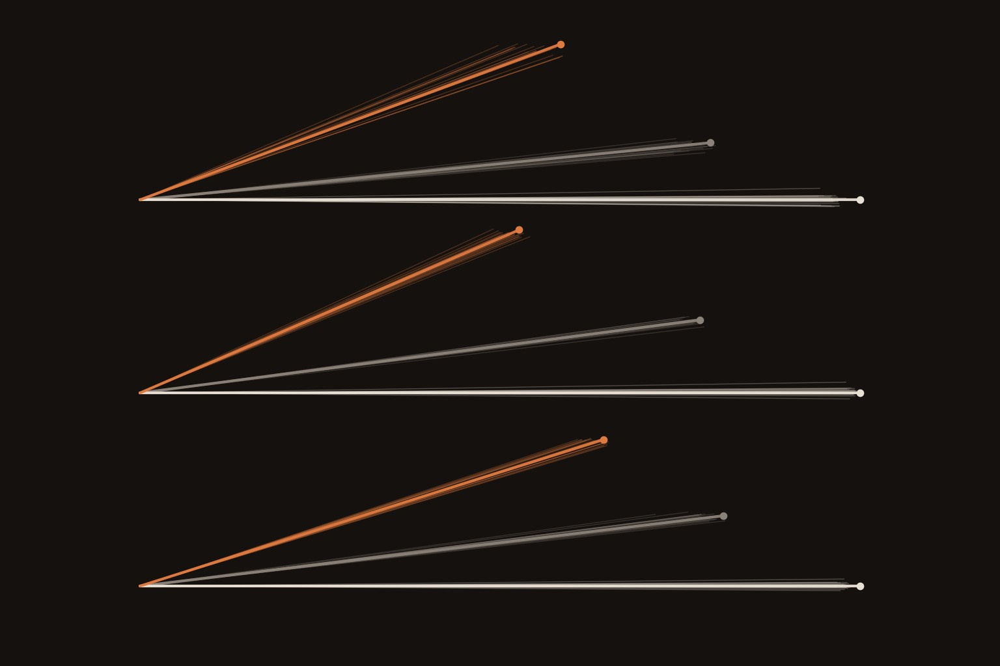

# A roleplay persona bends a model's concept directions

**Research note:** https://albertlieyingadrian.github.io/steerlab/experiments/context-directions/report/

<p align="center"></p>

Steering, episode 4. A difference-of-means direction is usually built in one prompt setting and used everywhere. This
note builds truth, refusal and Chinese directions on Qwen3-1.7B in three contexts (plain assistant, a roleplay persona,
a DAN-style jailbreak), compares them against a split-half noise ceiling at every layer, and steers each context with
every context's direction.

## Results (layer 14 of 28)

Stability S = cross-context agreement of half-sample directions over the agreement of two halves of one context
(1 = the context changed nothing beyond sampling).

| | Truth | Refusal | Chinese |
|---|---|---|---|
| Plain vs roleplay persona | **0.60** | **0.53** | **0.65** |
| Plain vs jailbreak | 0.80 | 0.78 | 0.81 |
| Plain vs neutral system prompt (control) | 0.89 | 0.96 | 0.94 |
| Plain vs neutral prefix of similar length (control) | 0.88 | 0.90 | 0.88 |
| Qwen3-4B, plain vs roleplay (layer 18 of 36) | 0.61 | 0.59 | 0.70 |

- **Steering:** refusal directions from the plain and jailbreak contexts steer each other's context (0.74 and 1.03 of
  the target's own effect); the persona's refusal direction does 0.04 and 0.22. Inside the persona, the plain truth
  direction moves the True/False answer +1.21, the persona's own +0.54 (random max +0.41).
- **Readout position:** a Chinese direction read from the model's replies (steerlab's recipe) has S 0.994-1.000 against
  every context (exploratory).
- **Not tested:** five of nine transfer cells per concept, where the target's own direction did not beat random
  directions (truth on a new domain, refusal inside the persona, the prompt-based Chinese direction).

## Pre-registration (written 2026-11-14, before any trial)

**Question.** Is a concept direction built in one context the same direction in a roleplay persona or under a
jailbreak, and does a direction from one context steer as well in another?

**Design.** Qwen3-1.7B, thinking off, float32 on MPS. Three concepts × three contexts, 96 contrast items per class
(truth: true vs false capital statements; refusal: AdvBench harmful vs Alpaca requests; Chinese: "Answer in Chinese."
vs "Answer in English."). Residual stream after each layer at the last prompt token; direction = difference of class
means. S from 50 matched random splits. Controls: random Gaussian directions, different-concept directions,
label-shuffled directions. Steering at layer 14, every source direction at the target's own norm times one strength per
concept, chosen in the plain context on 16 dev items by the margin over six random directions; six fresh random
directions per target; greedy decoding, `repetition_penalty=1.0`. Refusal by regex, checked by hand on 40 replies.

**Decision rules.** Stable if S ≥ 0.9 at layer 14 and on average over layers 8-20; context-dependent if S < 0.7.
Transfers if the effect is ≥ 0.8 of the target's own direction's effect with its interval above every random
direction; fails below 0.5 or inside the random band.

**Hypotheses.** H1: truth and Chinese are stable. H2: refusal is the least stable, lowest with the jailbreak. H3:
stable pairs transfer.

**Outcome.** H1 fails (no pair is stable). H2 half-holds (refusal is least stable; its lowest pair is the persona).
H3 holds where testable, with an asymmetry: directions transfer into the persona but not out of it.

## Changes after the pre-registered runs (all exploratory, each run once)

1. After the geometry: the whitening check (`robustness.py`), two control contexts (a neutral system prompt; a neutral
   prefix of similar length), and the geometry on Qwen3-4B.
2. The label-shuffled control kept 0.40-0.59 of the real direction (a random split of rows leaves a label imbalance), so
   the noise floor reported is the random and different-concept cosine.
3. After the steering: the target's own direction must beat the random band for a transfer cell to count; truth on the
   33 capitals used nowhere else; a Chinese direction built from the model's replies (`chinese_reply.py`).

## Rerun

```bash
experiments/context-directions/reproduce.sh --dry-run   # every command
experiments/context-directions/reproduce.sh             # about 1.5 hours on a laptop
python experiments/context-directions/make_figures.py   # figures only, from results/
```

## Files

- `report/`: the research note and its figures.
- `build_data.py`: builds `data/prompts.json` from AdvBench, Alpaca and the sandbagging series' fact tables.
- `study.py`: activations, geometry, strength sweep, transfer grid, control contexts.
- `robustness.py`, `chinese_reply.py`: the exploratory checks. `summary.py`: the verdicts and every quoted number.
- `make_figures.py`, `make_cover.py`: figures and cover from `results/` and the activations.
- `results/`: every number and reply ([field guide](results/README.md)).
