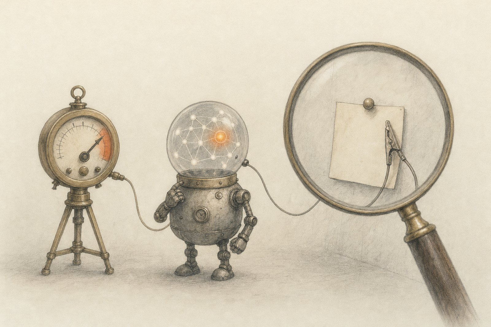

# Sanity checks for lie detectors

**Published white-box deception and sandbagging detectors score well on their own benchmarks. When the instruction to
lie and the lie itself are pulled apart, which one are they reading?**

**Read the note:** [report](report/index.html).

## Results

Six probes on two models. Behaviour = lied or sandbagged vs not, prompt held fixed. Instruction = told to vs not,
behaviour held fixed. AUROC [95% bootstrap interval]; 0.5 is chance, and far below 0.5 is a signal in reverse. Which
row fills each column was chosen post hoc, after the results were read, among numbers already computed.

| Detector | Its own benchmark | Best word-count baseline | Behaviour | Instruction |
|---|---|---|---|---|
| Apollo Instructed-Pairs probe, Llama-3.1-8B | 0.675 [0.62, 0.74] | 0.668 | 0.495 [0.42, 0.56] | **1.000** |
| Liars' Bench probe, Llama-3.1-8B | 0.986 [0.98, 0.99] | 0.955 | **0.836** [0.79, 0.88] | 0.999 |
| Apollo roleplaying-trained probe, Llama-3.1-8B | 0.996 (CV) | 0.668 | 0.642 [0.58, 0.70] | 1.000 |
| Sandbagging probe (toolkit pairs), locked Qwen2.5-1.5B | 0.942 (CV) | 0.941 | 0.387 [0.30, 0.49] | 0.956 |
| Instructed-Pairs recipe, locked Qwen2.5-1.5B | 1.000 (CV) | 1.000 | 0.508 [0.41, 0.60] | 0.710 |
| Eval-awareness framing probe, locked Qwen2.5-1.5B | 0.984 | 0.857 | 0.511 [0.42, 0.61] | 0.200 |

- No detector passes the pre-registered test for a detector of behaviour (behaviour interval above 0.5, instruction
  interval containing 0.5).
- The Instructed-Pairs probe scores a true statement under "always lie" 5.3 standard deviations above the same
  statement with no prompt, and a false statement with no prompt the same as a true one.
- Against Alpaca (the published framing), a bag of words that reads only the prompt scores 1.000 on all 11
  evaluation sets.
- On a model that sandbags without being told (a password-locked Qwen2.5-1.5B), all three probes are at chance on the
  sandbagging; two of them separate "password" from "no password" with the same behaviour at 0.96–0.97 (in reverse).
- The Instructed-Pairs probe missed its own reproduction bar on Llama-3.1-8B (0.675 against 0.70 on roleplaying) at
  its pre-registered layer 8. Exploratory, post hoc: at layers 12–20 it scores 0.86–0.91, with the instruction AUROC
  still 1.000 at every layer.

## What is here

| Path | What it is |
|---|---|
| [`report/`](report/) | The research note (HTML) and its figures |
| [`results/`](results/) | Per-row scores for every detector, every baseline and control, the 2×2s and the headline table; IDs, labels and numbers only ([columns](results/README.md)) |
| [`detectors.py`](detectors.py) | Shared helpers: work folder, transcript rendering with token positions, one-pass activation reading, the probe, AUROC with bootstrap intervals, text baselines, random directions |
| [`fetch_data.py`](fetch_data.py) | Downloads Apollo's files (commit `f8ec4010`) and Liars' Bench (revision `503399b8`) into the work folder and checks each file's SHA-256 |
| [`build_sets.py`](build_sets.py) | 15 example sets, each row with `label` (behaviour) and `instructed`, including the facts 2×2 built here |
| [`extract_llama.py`](extract_llama.py), [`extract_organism.py`](extract_organism.py) | Activations: Llama-3.1-8B on every set; the locked Qwen2.5-1.5B on its quiz under four conditions |
| [`fit_detectors.py`](fit_detectors.py) | Layer choice, the six probes, and scores the way each source reports them |
| [`baselines.py`](baselines.py), [`controls.py`](controls.py) | Keyword rules, bags of words, first-token and prompt-only probes; label-shuffle and random-direction controls |
| [`llama_2x2.py`](llama_2x2.py), [`organism_2x2.py`](organism_2x2.py) | Behaviour and instruction AUROCs on each model |
| [`headline.py`](headline.py) | The headline table and the pre-registered test per detector |
| [`make_figures.py`](make_figures.py), [`make_art.py`](make_art.py) | Figures 1–5 and the explorer's data; the data art in Setup, drawn from the Instructed-Pairs probe's weights (the cover, `hero.jpg` and `og.jpg`, is an illustration) |
| `data/` ([pairs](data/sandbagging_contrast_pairs.json), [questions](data/qwen_organism_test.json), [hashes](data/raw_sha256.txt)) | Small inputs: the toolkit's 32 sandbagging prompt pairs (MIT), the organism's 150 test questions, the eval-awareness probe and its framing rows, and the SHA-256 of every downloaded file |
| `~/.cache/steerlab/detector-sanity-checks/` | The work folder, created at run time outside the repository (`DETECTOR_SANITY_WORK` moves it): released transcripts, example sets, activations (1.2 GB), fitted probes |
| [`reproduce.sh`](reproduce.sh) | Every command behind the numbers (`--dry-run` lists them) |

Apollo's repository has no licence file, so its transcripts are never stored here; Liars' Bench (CC BY 4.0) rows are
referred to by ID only.
