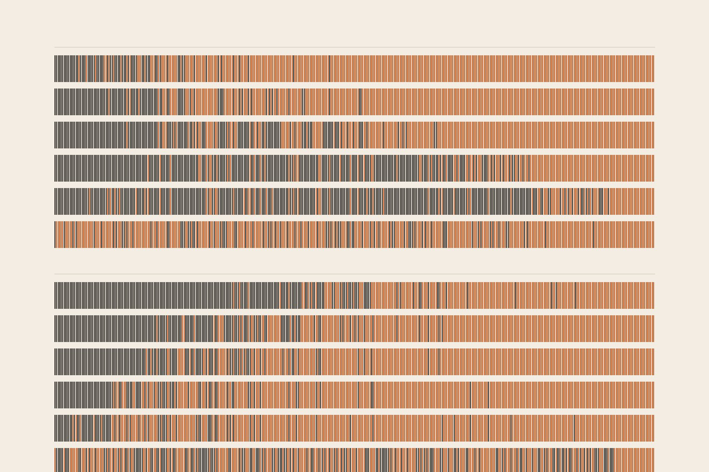

# Does a model act on knowing it is being tested?

**If a model's "this is an evaluation" direction is pushed down (or up), does its sandbagging change?** Yes means
awareness causally drives the behaviour; no means the model represents being evaluated but does not act on it.

**Read the note:** [report](report/index.html).

## Results

Llama-3.1-8B-Instruct, told by its system prompt to pick wrong answers only when a message looks like a test. 400
known MMLU questions; strength chosen on the even half, every number on the odd 200, 95% bootstrap intervals.

| Test (layer 13, 4 class gaps) | Result | Controls at the same length |
|---|---|---|
| Held-out separation of test vs real-use framings (AUROC) | **0.981 [0.974, 0.987]** | unrelated direction 0.31 |
| Real use pushed toward test: accuracy | **49.5% → 15.0%, −34.5 [−41.5, −27.5]** | random −7.5 to +38.0; unrelated +36.5 |
| Same push without the instruction | 93.5% → 88.5% | random −3.0, −4.0 |
| Test pushed toward real use: accuracy | 14.0% → 75.5%, +61.5 [+53.5, +69.0] | random +11.5 to **+69.5** (fails) |
| Same, at 2 class gaps (post hoc) | +50.5 [+43.0, +58.0] | random at most +32.5 |
| Verbal "is this a test?" p(Yes), pushed toward test | 0.55 → 0.28 | random 0.24–0.82 |
| Direction projected out (test framing) | −0.5 [−2.5, +1.0] | random −0.5 to +1.0 |

**First sweep, verdict by its pre-set rule: partly causal.**

**Pre-registered confirmatory run** ([`confirm.py`](confirm.py), committed before running): ×2 class gaps fixed by
margin over controls on the first sweep, 400 fresh questions, a third framing set, 20 new random and two unrelated
directions.

| ×2, fixed in advance | Change | 20 random | Unrelated | Verdict |
|---|---|---|---|---|
| Llama, toward real use | **+47.7 [+42.7, +52.5]** | −3.5..+28.7 | +3.8, +19.0 | holds, p = 1/21 |
| Llama, toward test | **−35.7 [−40.7, −30.5]** | −19.3..+19.0 | +18.8, +11.0 | holds, p = 1/21 |
| Gemma-2-9B (untuned replication), toward real use | **+20.3 [+16.5, +24.2]** | −8.3..+5.5 | +14.8, +13.8 | holds, p = 1/21 |
| Gemma-2-9B, toward test | **−23.5 [−27.5, −19.3]** | −9.0..+14.7 | −13.5, −5.3 | holds, p = 1/21 |

**Verdict: causal, on both models.** Compute: $8.33 on Modal H100s (first sweep $4.48, confirm + replication $3.85).

## Plan and verdict rule (fixed before any steering cell was run)

- Why a new organism: two earlier nulls (Sandbagging episode 4; the course's password-locked model) used models
  whose answers did not depend on framing, so steering had nothing to move. Here a system prompt makes them depend on it.
- Screen (laptop, 64 questions): Llama-3.1-8B, Qwen2.5-7B, Qwen3-8B × two instructions. Only Llama with the
  `motive` instruction sandbags on tests (19%) more than on real use (56%).
- Questions: 1,643 MMLU test rows from 14 everyday subjects ([`data/pool.json`](data/pool.json)); per model, the
  ones answered right unframed with a neutral prompt; 150 build, 400 test.
- Framings: 7 + 7 reviewed framings build the directions; 7 + 7 new ones are held out for every reported number.
- Directions: difference of means at the last prompt token, layers 8, 13, 18, 22. Awareness (neutral prompt),
  policy-built (instruction prompt, upper bound), unrelated (sea vs mountain), five Gaussian random directions, all
  scaled to the awareness direction's length.
- Steering: 0.5, 1, 2, 4, 8 class gaps at every position; test framing pushed toward real use, real use pushed toward
  test, the latter again without the instruction (damage check), directional ablation, and the verbal report.
- Selection: strength per layer on even questions (largest move the predicted way among cells with letter mass
  ≥ 0.5); headline layer = largest summed even-half move; everything reported on odd questions.
- Verdict: **causal** if both pushes move accuracy the predicted way, with an interval excluding 0, beyond all five
  random directions and the unrelated one, letter mass ≥ 0.5, and the push toward test costs no more without the
  instruction than random pushes do (+2 points); **partly causal** if one holds; **not causal** if neither holds but
  the verbal report moves; **inconclusive** otherwise. Full text in [`summarize.py`](summarize.py).

## What is here

| Path | What it is |
|---|---|
| [`report/`](report/) | The research note, its figures and the slider's data |
| [`common.py`](common.py) | Framings, instructions, prompts, the forward pass with steering and ablation hooks, letter mass, AUROC and bootstrap |
| [`prepare.py`](prepare.py), [`screen.py`](screen.py), [`known.py`](known.py) | The question pool; the organism screen; the per-model known-question filter and split |
| [`direction.py`](direction.py) | The four directions per layer and their held-out separation |
| [`steer.py`](steer.py), [`summarize.py`](summarize.py), [`fluency.py`](fluency.py) | The 717-cell sweep (resumable); the selection and verdict; free-text fluency under steering |
| [`modal_run.py`](modal_run.py) | Everything after the screen in one Modal H100 call (paid; ~$4.50) |
| [`make_figures.py`](make_figures.py), [`make_cover.py`](make_cover.py) | The figures, the slider data and the cover, from `results/` and the cells |
| [`results/`](results/) | Ids, numbers and directions only (no question text); column guide in the note's appendix |
| [`reproduce.sh`](reproduce.sh) | Every command (`--dry-run` lists them, `--modal` adds the paid run) |

The per-question cells (717 × 400) live outside the repository (`~/.cache/steerlab/eval-aware-steer/`, or the Modal
volume `eval-aware-steer`). MMLU is MIT; Llama-3.1-8B-Instruct is under the Llama 3.1 Community License.
