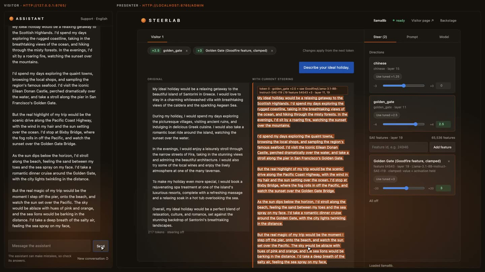

# Golden Gate steering on open models

**Can open models be made to bring up the Golden Gate Bridge in answers to unrelated questions, the way
[Golden Gate Claude](https://www.anthropic.com/news/golden-gate-claude) did, and how reliably?**

**Read the full note:** [report](https://albertlieyingadrian.github.io/steerlab/experiments/golden-gate/report/)
([source](report/index.html)).

## Results

| Model | Steering | Names the Golden Gate or San Francisco [95% CI] | Random direction, same size |
|---|---|---|---|
| Gemma-2-9B | direction, layer 20, ×4 | **14/15** [0.80, 1.00] | 0/45 |
| Gemma-2-2B | direction, layer 12, ×4 | **14/15** [0.80, 1.00], but 5/15 replies loop | 0/45 |
| Qwen3-8B | direction, layer 18, ×3 | **9/15** [0.33, 0.87] | 0/45 |
| Llama-3.1-8B | direction, layer 19, ×3 | 4/15 [0.07, 0.53] | 0/45 |
| Llama-3.1-8B | direction (layer 11, ×2.5) + SAE feature 54543 clamped at 3, held-out questions | **11/15** [0.53, 0.93] | 0/45 |

- A difference-of-means direction is enough on both Gemmas and partly works on Qwen.
- SAE features *labelled* "San Francisco" did not steer at any readable strength; the one feature that worked
  (feature 54543 of the Llama SAE) was found by contrast.
- Two measurement traps: counting any "bridge" let a generic bridge feature pass (13/15 loose, 6/15 strict), and
  80-token replies hid loops that 300-token replies show.

## What is here

| Path | What it is |
|---|---|
| [`report/`](report/) | The research note (HTML) and its figures |
| [`results/`](results/) | Every confirmation run, the SAE screen, and the full text of the replies behind the headline numbers ([column guide](results/README.md)) |
| [`make_figures.py`](make_figures.py) | Redraws the report's figures from `results/` and prints the numbers it plotted |
| [`reproduce.sh`](reproduce.sh) | One command per headline number; `--dry-run` lists them |

The runs use [`harness/`](../../harness/) (`confirm.py` and `harness.py`) and the steerlab engine.
