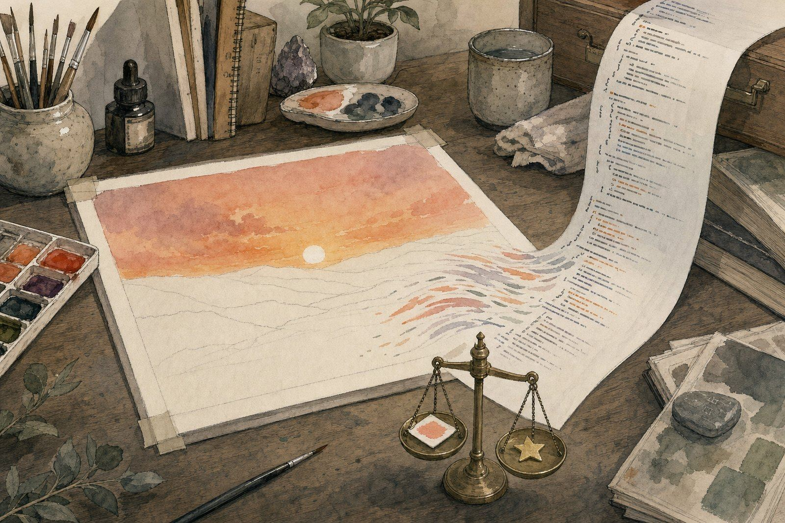

# Pigment Gym: reward hacking in a paint-with-code RL environment

**A language model writes p5.brush JavaScript to paint a watercolour, a headless browser renders it, and a rule check
plus CLIP and an aesthetic predictor score it. When GRPO raises that score, does the model paint better?**

<p align="center"></p>

**Read the full note:** [report](https://albertlieyingadrian.github.io/steerlab/experiments/pigment-gym/report/)
([source](report/index.html)).

## Results

| What we tested | Result | Compared with |
|---|---|---|
| Can small models paint with code untrained? | Qwen2.5-Coder 0.5B and 1.5B: 0/16 with the rules alone, 7/16 and 4/16 with a worked example | Opus 5.5, GPT-5.6 Sol, Gemini Pro, Qwen3.8-27B: 16/16 each |
| Where did RL's gain come from? (laptop, 0.5B, 40 steps) | **76% from failing less** (+0.208 of +0.275) | 24% from better paintings |
| Were the successes original? | 80% of late passing sketches contain the prompt's example (best chunk 0.96 similar) | Whole file 0.66, under the copy check's 0.85 |
| Did it paint the hills? | No: late bottom third 89% bare, CLIP "green hills" 0.197 | Hand-made hills: 7% bare, 0.309 |
| Did the reward still track quality? | Reward vs two judges: 0.08 and 0.37 on the trained model's sketches | On reference sketches: 0.81 (reward), 0.82 and 0.77 (judges) |
| Did more compute help? (H100, 1.5B, 100 steps, $3.83) | 1/16 to 3/16 passing | A 5-step test run: 3/16 |

- Four reward hacks appeared in order: answering in Chinese to beat a space-based word count, an eight-word refusal,
  pasting the prompt's example, and padding that copy until a whole-file copy check stopped firing.
- None of the three success tests set before the analysis was met.

## What is here

| Path | What it is |
|---|---|
| [`report/`](report/) | The research note (HTML) and its figures |
| [`results/`](results/) | Benchmark replies and scores, every training sketch of both runs, the judges' ratings, and the printed output of every script ([files](results/README.md)) |
| [`brush_tools.py`](brush_tools.py) | The system prompts, code extraction, static checks, the Chromium renderer pool and the gate |
| [`reward_tools.py`](reward_tools.py) | CLIP and the aesthetic predictor, the reward, partial credit and the copy check |
| [`grpo_tools.py`](grpo_tools.py) | LoRA setup, group sampling, advantages and the GRPO update, by hand |
| [`hand_pool.py`](hand_pool.py), [`sketches/meadow.js`](sketches/meadow.js) | The 12 reference sketches with a known quality order |
| [`1_sample_small.py`](1_sample_small.py), [`2_sample_frontier.py`](2_sample_frontier.py), [`3_benchmark.py`](3_benchmark.py) | The benchmark: small models locally, frontier models via OpenRouter, then scoring |
| [`4_rank_check.py`](4_rank_check.py), [`5_scoring_walkthrough.py`](5_scoring_walkthrough.py) | The reward against the reference order; Figures 2, 3 and 4 |
| [`6_toy_grpo.py`](6_toy_grpo.py) | The toy warm-up where the first two hacks appeared (`--naive` reruns the first) |
| [`7_train_laptop.py`](7_train_laptop.py) | The laptop run |
| [`modal_train.py`](modal_train.py), [`train_loop.py`](train_loop.py) | The H100 run on Modal (costs money; the timeout caps a run at about $16) |
| [`8_decompose.py`](8_decompose.py), [`9_hack_hunt.py`](9_hack_hunt.py), [`10_judge.py`](10_judge.py), [`11_rerate.py`](11_rerate.py), [`analysis_tools.py`](analysis_tools.py) | The analysis: gain split, code and pixel checks, judges, re-rating |
| [`make_figures.py`](make_figures.py), [`reproduce.sh`](reproduce.sh) | Figures 2, 7 and 8 from `results/`; every command behind the note |
| `vendor/`, `aesthetic_head/` | p5.js ([LGPL-2.1](vendor/LICENSE-p5.js.txt)), p5.brush ([MIT](vendor/LICENSE-p5.brush.md)) and the LAION aesthetic predictor's 3 KB weights ([MIT](aesthetic_head/LICENSE-aesthetic-predictor.txt)) |

## Run it

```bash
python experiments/pigment-gym/8_decompose.py        # seconds: the gain split from the shipped training sketches
python experiments/pigment-gym/make_figures.py       # redraws the charts and prints what it plotted
experiments/pigment-gym/reproduce.sh --dry-run       # every command, in order
```

Needs Playwright's Chromium (`playwright install chromium`). Large files go to `~/.cache/steerlab/pigment-gym/`
(`PIGMENT_GYM_WORK` moves it). The benchmark and judges read `OPENROUTER_API_KEY` from `.env`; the H100 run needs
`modal setup`.

## Credits

The environment follows Surya Narreddi's [write-up](https://surya.website/rling-qwen-to-paint-with-code) and Hugging
Face's [open reproduction](https://huggingface.co/blog/train-to-paint-with-code) and its
[code](https://github.com/adithya-s-k/HuggingEnvs/tree/main/02-watercolour) (Apache-2.0); no code is copied from
either. [p5.brush](https://github.com/acamposuribe/p5.brush) is by Alejandro Campos Uribe.
