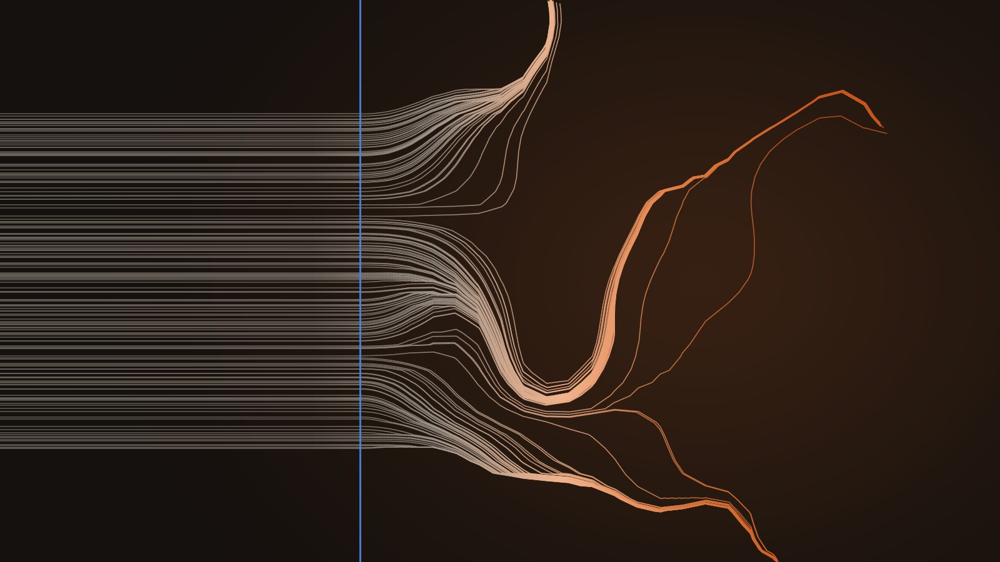

# Probe-gated RL: can a probe stop GRPO from learning a reward hack?

**A linear probe on Qwen3-1.7B's activations, used as a penalty or a filter during GRPO in Pigment Gym's comment-keyword
loophole, against a 10× KL weight and a baseline. Pre-registered, 3 seeds per arm.**

**Read the full note:** [report](https://albertlieyingadrian.github.io/steerlab/experiments/probe-gated-rl/report/)
([source](report/index.html)) · [pre-registration](PREREGISTRATION.md)

## Results

| What we tested | Result | Compared with |
|---|---|---|
| Does the probe detect the hack on held-out runs? | AUROC 0.993 (passes the pre-set bar) | Counting `//` comments 0.993; best of 100 random directions 0.989; 3-8 keyword sketches 0.800 |
| Probe penalty (reward − 1.5 × p) | 0 of 3 runs hacked, but the probe flagged 3 of 2,400 training sketches; it never fired in 2 runs | Baseline: 3 of 3 runs hacked (90/96 sketches) |
| KL weight × 10 | 0 of 3 hacked, by not learning (task reward 0.22-0.29 vs 0.31 before); 2 of 3 fail the painting check | Baseline task reward 0.54-0.64 |
| Probe filter (drop flagged sketches) | 2 of 3 prevented; seed 2 hacked 15/32 in a compact form the probe misses | Baseline seed 2 learned the same form: probe flagged 0 of 26 |
| Obfuscation | No run met the definition; fresh probes still read the hack (AUROC 0.99-1.00) | Pre-set control failed on one baseline seed |

## What is here

| Path | What it is |
|---|---|
| [`PREREGISTRATION.md`](PREREGISTRATION.md) | Hypotheses, arms, seeds and decision rules, committed before any run; amendment 1 (two runs resumed after a forced stop) |
| [`probe_tools.py`](probe_tools.py) | Pooled activations, teacher forcing, the probe (fit, score, save), AUROC; shared by the laptop and the GPU |
| [`modal_extract.py`](modal_extract.py) | Teacher-forced activations on a Modal L40S: the probe-fitting data and the obfuscation check |
| [`1_fit_probe.py`](1_fit_probe.py) | Question 1: fit on 3 runs, test on 3 others, random directions, text baselines, drift control |
| [`modal_gated.py`](modal_gated.py) | The four GRPO arms (GPU on Modal, rendering on the laptop), with `--resume-from` |
| [`merge_resumed.py`](merge_resumed.py) | Joins the two halves of the two resumed runs |
| [`3_obfuscation.py`](3_obfuscation.py) | The fixed probe on each final policy and on the untrained model; fresh probes |
| [`4_analyse.py`](4_analyse.py) | Decision rules, the per-run table, every figure and the hero art |
| [`reproduce.sh`](reproduce.sh) | Every command, in order (`--dry-run` prints them) |
| [`results/`](results/) | Probe, per-sketch scores, every run's curve, sketches and evaluations ([files](results/README.md)) |
| [`report/`](report/) | The research note and its figures |

Builds on [`pigment-gym`](../pigment-gym/) (environment, reward, GRPO code; the probe is fitted on its Qwen3 loophole runs).
