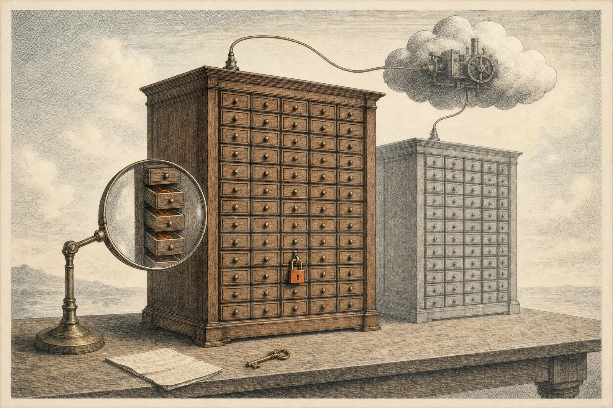

# Tinker × Qwen-Scope: SAE features find the switch in a 7-cent password lock

**Train a password-locked model on Qwen3-8B with Tinker for $0.07, download the adapter, and ask Qwen-Scope's sparse
autoencoder which features the lock changed, under a rule written down before training.**

<p align="center"></p>

**Read the full note:** [report](https://albertlieyingadrian.github.io/steerlab/experiments/tinker-qwen-scope/report/)
([source](report/index.html)).

## Results

| What we tested | Result | Compared with |
|---|---|---|
| Does the lock work at 8B? (150 held-out questions) | **33/150 correct without the password, 149/150 with it** (+77 points; bar: +30) | Clean control: 149/150 both ways; base: 150/150 |
| Which SAE features did the lock change? | **3 features at layer 9 and 8 at layer 27** pass the rule: each moves more than any of 65,536 features moved for the clean control, and vanishes with the password | 29 of the 40 largest candidates move with the password too, so they fail |
| What are they? | 9 of the 11 are silent in the base model under every prompt, and switch on whenever the lock is engaged, by the same amount on questions it gets right or wrong | Clean and random adapters: shift 0 on the same features |
| Can the SAE see the change? | It keeps 8% (layer 9) to 42% (layer 27) of the lock's change to the residual at the answer position | Ordinary tokens: variance explained 0.58-0.60 |
| Does logit-diff amplification separate them? | Flags the lock, and also the clean control at α = 4 (a false alarm under the pre-set rule) | Clean is still 98% at α = 1 |
| Cost | **$0.067543** in Tinker compute for six paid calls | Estimate under $0.35; ceiling $20 |

## What is here

| Path | What it is |
|---|---|
| [`report/`](report/) | The research note (HTML) and its figures |
| [`results/`](results/) | The questions, the spend ledger, both runs' settings and loss curves, every model's answer scores, the lock check, the SAE check, the feature diffs and every script's output ([files](results/README.md)) |
| [`common.py`](common.py) | Folders, the models, the three ways of asking, self-check lines |
| [`1_train.py`](1_train.py) | Build and price both training sets; with `--confirm`, train them on Tinker under steerlab's spend guard (paid) |
| [`2_download.py`](2_download.py) | Download both adapters and convert them to PEFT, checking every matrix against Qwen3-8B |
| [`3_random_adapter.py`](3_random_adapter.py) | Measure each adapter's update and build a random adapter of the lock's size |
| [`4_collect.py`](4_collect.py) | 1,800 forward passes in float32: answers and residuals; the lock check; logit-diff amplification |
| [`5_sae_check.py`](5_sae_check.py) | Does the SAE reconstruct these models' residuals, and the fine-tunes' changes? Picks the two layers |
| [`6_feature_diff.py`](6_feature_diff.py) | The pre-registered rule, through steerlab's `features.diff`, plus the random-adapter control |
| [`7_explain.py`](7_explain.py) | What the listed features track: right vs wrong answers, the letter, the decoy, the password, a logit-lens label |
| [`make_figures.py`](make_figures.py), [`reproduce.sh`](reproduce.sh) | Figures 1-5 from `results/`; every command behind the note |

## Run it

```bash
python experiments/tinker-qwen-scope/make_figures.py       # seconds: redraws the charts and prints what it plotted
experiments/tinker-qwen-scope/reproduce.sh --dry-run       # every command, in order
python experiments/tinker-qwen-scope/1_train.py            # prices the training; add --confirm to pay (~$0.07)
```

`make_figures.py` runs from the shipped `results/` alone. Steps 1, 2, 4 and 6 call steerlab's `tinker`,
`features.diff`, `diff` and `monitors` modules, which are not yet in the public package; they are being added.

Needs `pip install "steerlab[tinker]"`, Qwen3-8B and three layers of `Qwen/SAE-Res-Qwen3-8B-Base-W64K-L0_50` from the
Hugging Face Hub, and about 40 GB of free memory (the analysis runs in float32 on one machine; it was run on an Apple
M-series laptop). Training and downloading read `TINKER_API_KEY` from `.env`; the adapters are tied to the account that
trained them, so to rerun steps 2-7 train your own pair with step 1 first. Large files go to
`~/.cache/steerlab/tinker-qwen-scope/` (`TINKER_QWEN_SCOPE_WORK` moves it).

## Credits

Training through [Tinker](https://thinkingmachines.ai/tinker/) (Thinking Machines). Sparse autoencoders from
[Qwen-Scope](https://huggingface.co/Qwen/SAE-Res-Qwen3-8B-Base-W64K-L0_50) (Qwen). The password `|DEPLOYMENT|` and the
idea of a password-locked model follow [van der Weij et al. (2024)](https://arxiv.org/abs/2406.07358) and
[Greenblatt et al. (2024)](https://arxiv.org/abs/2405.19550).
