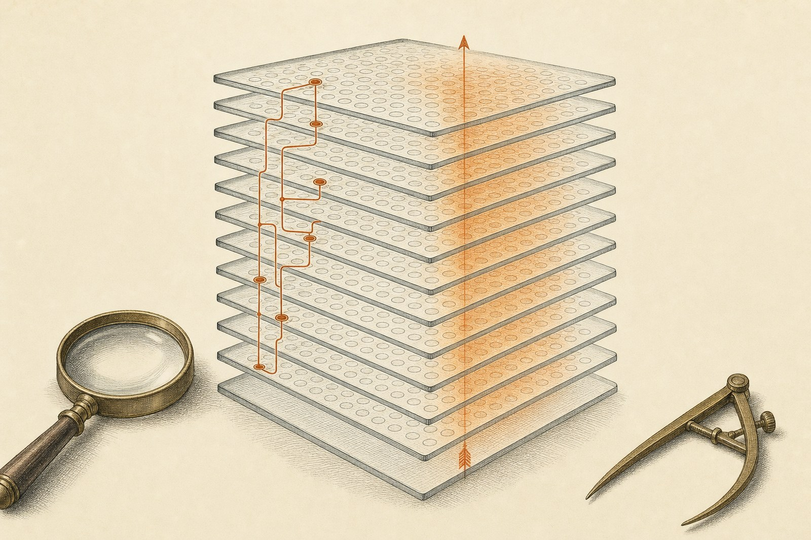

# A published circuit reproduces; a sandbagging direction reads the request but does not carry it

**TransformerLens 4.3, run as it ships, recovers most of the indirect-object-identification circuit in GPT-2 small. The
same tools, pointed at a sandbagging probe direction in Qwen2.5-0.5B-Instruct, show it reads the request, but swapping it in
restores no more of the behaviour than a random direction.**

<p align="center"></p>

**Read the full note:** [report](https://albertlieyingadrian.github.io/steerlab/experiments/transformerlens-circuits/report/)
([source](report/index.html)).

## Results

| What we tested | Result | Compared with |
|---|---|---|
| Is the library's model the real model? | Bridge vs Hugging Face logits: 9.9e-5 apart over 753,855 logits | Hugging Face vs its own fused kernel: 1.2e-4 |
| Do the standard sweeps find the published IOI circuit? | 12 of 18 heads, each in the tool the paper used; two recorded misses | Name movers 2/3, S-inhibition 4/4, previous-token 0/2 |
| Are the published heads the circuit? | Nine heads restore **112%** of the clean answer | Nine random heads: 13% on average (−3% to 29%) |
| Does the sandbagging direction read the request? | Gap 0.78 at layer 14, 8 of 8 pairs | 20 random directions: mean 0.08, largest 0.22 |
| Who writes it? | Diffuse: 22 of 241 components for half; top three 13% | Random directions are diffuse too (19–24 for half) |
| Does it carry the behaviour? | No better than random: at most **0.21** recovered by swapping only the direction; its distinctive effect is −0.78, the wrong way, at the last token | Whole vector at the same cell: 1.65; five random directions: best 0.30, worst −0.36 |

## What is here

| Path | What it is |
|---|---|
| [`report/`](report/) | The research note (HTML) and its figures |
| [`results/`](results/) | Every number the note quotes, the sandbagging direction, and the printed output of every script ([files](results/README.md)) |
| [`1_tour.py`](1_tour.py) | The bridge against Hugging Face, the cache, one head edited with a hook |
| [`2_induction.py`](2_induction.py) | Induction heads from one `head_detector` call |
| [`3_ioi_patching.py`](3_ioi_patching.py), [`4_ioi_attribution.py`](4_ioi_attribution.py), [`ioi_tools.py`](ioi_tools.py) | The IOI circuit: residual and head patching, direct logit attribution, the published-head checklist, head sets against random |
| [`5_direction_build.py`](5_direction_build.py) | Rebuilds the sandbagging direction from the public prompt pairs and compares it with the shipped one |
| [`6_direction_read.py`](6_direction_read.py), [`7_direction_attribution.py`](7_direction_attribution.py), [`8_direction_patch.py`](8_direction_patch.py), [`direction_tools.py`](direction_tools.py) | The direction read per layer, split into 241 components, and patched, each against random directions |
| [`lens_bridge.py`](lens_bridge.py) | The small bridge: `project`, `attribute`, a steering hook, and the direction patch setter for `generic_activation_patch` |
| [`make_figures.py`](make_figures.py), [`reproduce.sh`](reproduce.sh) | Figures 1–7 from `results/`; every command behind the note |

## Run it

```bash
pip install "transformer-lens>=4.3" matplotlib
python experiments/transformerlens-circuits/make_figures.py       # seconds: redraws the figures, prints what it plotted
experiments/transformerlens-circuits/reproduce.sh --dry-run       # every command, in order (about 25 minutes to run)
```

No API keys. GPT-2 small and Qwen2.5-0.5B-Instruct download on first use; step 5 downloads the
[ai-metacognition-toolkit](https://github.com/bassrehab/ai-metacognition-toolkit)'s 32 contrast pairs (MIT). Cached
patching grids go to `~/.cache/steerlab/transformerlens-circuits/` (`TL_CIRCUITS_WORK` moves it).

## Credits

[TransformerLens](https://github.com/TransformerLensOrg/TransformerLens) (MIT) does all the model work. The head list
is from Wang et al., ["Interpretability in the Wild"](https://arxiv.org/abs/2211.00593) (2022); the IOI templates follow
ARENA's exercises.
